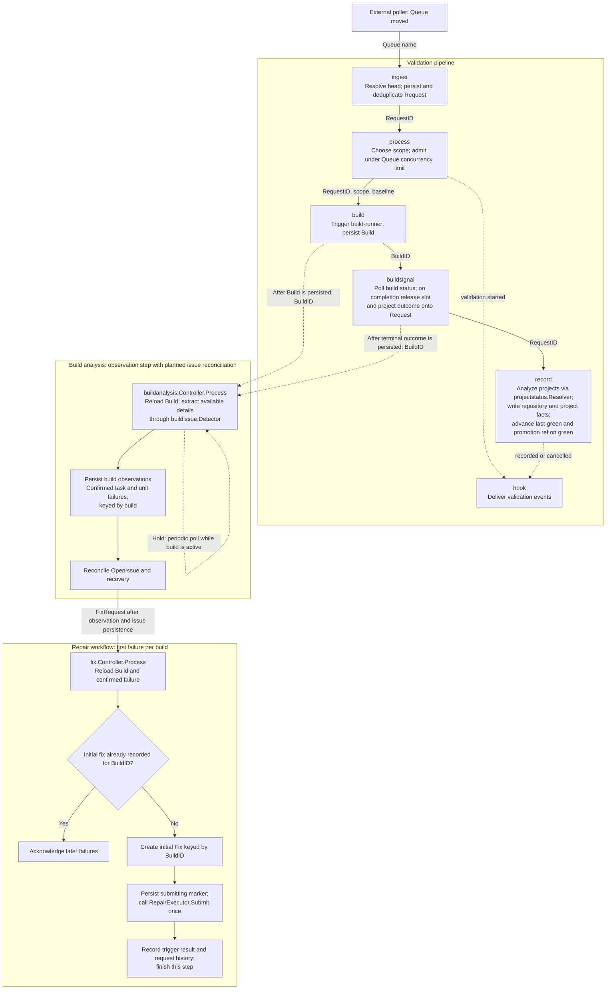

# Stovepipe Workflow

Stovepipe answers one question for the rest of the company: **at which commit is this thing green?** It continuously polls a repository branch for its latest commit, validates that commit, works out which projects (if any) are broken at it, records the result, and notifies downstream systems so they can gate deployments on a known-good commit. It is a post-land service: code lands first, Stovepipe finds out whether it was good.

The pipeline is a queue-driven chain of small, single-purpose controllers, in the same style as SubmitQueue (SQ). Each controller consumes one topic, advances one entity, and publishes to the next topic. Most hops carry only an **ID** and the controller reloads the entity from storage; the entry hop carries the caller's input because there is no row to load yet. What runs today is:

> **poll for a new head → ingest → process the build strategy → build → buildsignal → record whole-repo greenness (and any project results the resolver returns) → hook.**

The [buildanalysis step](steps/buildanalysis.md) runs alongside that chain. It uses `buildissue.Detector` to collect confirmed issues during a build and attempts a final pass after completion. The reference service supplies a no-op detector. Open-issue reconciliation, recovery, and repair dispatch are the next additions; the diagram includes their intended flow. Health tracking is a responsibility of buildanalysis. An issue is identified by a logical task and optional unit, with its first-seen build distinguishing one opening from another.

Project analysis is already implemented in `record` through [`projectstatus.Resolver`](../../../stovepipe/extension/projectstatus/projectstatus.go). It resolves project results and records their validation facts on the same delivery as the repository fact. As build analysis is added, project-result extraction and calculation may move there so project status and breakage tracking can share the same observations; `record` would continue to persist validation facts. See [Project analysis](#project-analysis).

## What Stovepipe is agnostic about

Two deliberate abstractions keep Stovepipe from being a git tool or a Bazel tool:

- **The VCS is behind a `SourceControl` extension.** Stovepipe never shells out to git. Every commit, ref, and branch head is an opaque **URI** that a `SourceControl` implementation produces and interprets. A ref is `git://remote/repo/ref/…`; a specific commit is `git://remote/repo/ref/…/<sha>`. The `git://` scheme is just the reference implementation — a Mercurial or Perforce backend would mint its own scheme behind the same contract. Nothing downstream of `SourceControl` parses a URI; it is a token you hand back to `SourceControl` to ask questions ("is A an ancestor of B?", "what is the head of this ref?").
- **The build system is behind a build-runner extension** (see [build-runner.md](../submitqueue/build-runner.md)). `Trigger` starts a build at a head URI, optionally against a baseline URI, and `Status` returns pass/fail plus metadata. Project results are resolved separately through `projectstatus.Resolver`.

Designing to these contracts — not to git and Bazel specifically — is the whole point: the same pipeline should validate any branch in any VCS built by any build system.

## Core concepts

### URI — the unit of identity for "where"

Everything Stovepipe records greenness *about* is a URI: a specific commit on a specific branch. The last-known-good commit is a URI; a build is run against a URI; a project's greenness is recorded against a URI. Because the URI is opaque, Stovepipe can compare, store, and key on it without knowing it is a git SHA.

### Queue — the unit of identity for "what we validate"

Stovepipe reuses SQ's **Queue** concept for the same two reasons SQ does — to **namespace the generated IDs** and to give callers a **stable handle for the repo+ref being validated** — plus a third that is specific to a post-land validator: a Queue **owns the last-known-good URI** and the greenness history for its branch.

A Queue is named by a **stable logical string** (e.g. `monorepo/main`), and that name is what the ingest API takes — *not* a raw URI. SourceControl/config resolves the Queue name to a concrete VCS URI base. This keeps callers (and the external poller) free of VCS detail: they say "the `monorepo/main` Queue has moved", and Stovepipe resolves what that means.

A Queue is *not* tied to trunk specifically — any branch can be a Queue. "Queue" here is the **validation namespace**; it is distinct from the **messaging queue** the pipeline runs on. Where the two could be confused, this doc says "messaging queue" for the transport and "Queue" for the namespace entity.

### Request — one validation of one head

When the poller reports that a Queue has a new head, Stovepipe mints a **Request** (its ID scoped by the Queue, minted exactly as the SQ gateway mints a request ID; see [Resource IDs](../submitqueue/workflow.md#resource-ids)) representing "validate this Queue at this head URI". The Request, not the URI, is the thing that flows through the pipeline and accumulates state (the chosen build strategy, the build outcome, the recorded greenness).

Identity for the *head* is the `(Queue, head URI)` pair, and that pair is the **dedup key**: if the poller reports the same head twice, or a future webhook producer races the poller, both resolve to the same Request and the work happens once. The minted Request ID is the routing handle; the dedup key is what makes ingestion idempotent.

### Greenness — a degree, not a boolean

Greenness is recorded as a **health degree** where **`0` means green** and **higher means more broken**, with **`1` meaning fully broken**. Stovepipe starts with only the two endpoints — `0` (green) and `1` (broken) — at the whole-repo level. Project resolvers can already return intermediate degrees for partial breakage; each implementation defines how it calculates them. A commit that has been ingested but not yet validated has *no* recorded greenness for the relevant scope — absence is distinct from `0`, and callers must treat "not yet recorded" as not-green for gating.

### Project — greenness at a finer grain

A **project** is a caller-defined slice of the repository. Whole-repo greenness answers "is the branch green at this URI"; project greenness answers the question deployments actually need — **"is *this project* green at this URI"**, and its dual, "what is the latest URI at which this project is green". Project analysis runs today in [`record`](steps/record.md#project-analysis). On a succeeded or failed request, `record` gives the request and its terminal build id to `projectstatus.Resolver` and writes one validation fact per result it returns. The example server wires the noop resolver, which returns no results. How a resolver chooses projects is implementer-specific. This derives project status from the existing validation build.

### Promotion ref — the last green commit, by name

A Queue may have a **promotion ref**: a stable branch name (say `verified-main` for `monorepo/main`) that Stovepipe advances to each commit it establishes green. A deploy gate or cache warmer then fetches that name and needs to know nothing about Stovepipe, URIs, or greenness degrees. It is the pull-shaped counterpart to Hooks' push: the same fact, available to consumers that would rather resolve a ref than subscribe to an event.

The ref is a *cache* of the last-green URI, not a second record of greenness. It only ever moves where the bookmark already points, so it inherits the same forward-only rule, and a commit that a history rewrite has dropped from the branch is skipped rather than retried — the next green commit corrects the ref. Which ref a Queue promotes to, and whether it has one at all, is `SourceControl` configuration resolved from the Queue name alongside the repo and credentials; the pipeline names only the commit, never a branch.

## Extensions

| Extension | Responsibility |
|---|---|
| **SourceControl** | Resolve a Queue name to its current head URI; answer ancestry/comparison questions between two URIs (is the new head a fast-forward descendant of the last green, or was history rewritten?); enumerate commits in a range; advance the Queue's **promotion ref** to a commit. The sole owner of URI semantics, including which refs a Queue name resolves to. |
| **build-runner** | Build a scope at a URI, optionally relative to a baseline URI. `Trigger` returns a build id; `Status` returns pass/fail and the caller-supplied metadata it echoed. It does not return a target graph. See [build-runner.md](../submitqueue/build-runner.md). |
| **projectstatus.Resolver** | Resolve project identities and health degrees from a terminal validation. Called by `record` today; extraction and calculation may move into build analysis. |
| **buildissue.Detector** | Return confirmed task and unit failures for a referenced Build. The implementation owns provider confirmation and automatic retry rules. |
| **Hooks** | Deliver Stovepipe's validation events to downstream systems. What is published today is repository-scoped: validation of this URI has begun, this URI is green or not green, and a cancelled validation ended without a fact. Fire-and-forget notification, decoupled so Stovepipe does not know or care who consumes the event. The shared cross-domain hook seam rather than a Stovepipe-specific extension. See [hook-framework.md](../hook-framework.md). |
| **Storage** | Persist Queues (incl. last-green URI), Requests, build records, and per-URI / per-project greenness. Key/value-shaped per the extension-design rules in [AGENTS.md](../../../AGENTS.md). |

Hooks are the notification boundary. When validation of a commit begins, when a whole-repository validation fact is recorded, and when a cancelled validation ends without a fact, the event reaches deployment systems, dashboards, and developer tooling without any of them polling Stovepipe's store, and each environment can route it to its own downstream (a deploy gate, a Slack notifier, an event bus) without changing the pipeline. The mechanism is the cross-domain hook framework rather than a call out of the pipeline stages: `process` and `record` publish a repository-scoped `HookEvent` to Stovepipe's `hook` topic, and a dispatcher stage consumes it and invokes the wired hooks, so a slow or failing downstream cannot add latency to the pipeline. Both halves exist; what a deployment supplies is the hooks themselves, since the example server resolves every event to `noop`. Per-project hook events are not published. See [process.md](steps/process.md#hooks) for the start event and [record.md](steps/record.md#hooks) for the fact-to-event mapping.

## Workflow

What runs is one pass per Request. It establishes whole-repository greenness, and on a succeeded or failed outcome `record` also gives the Request's terminal build id to `projectstatus.Resolver` before writing whatever project facts it returns. That call is inline on the record delivery. It does not publish to another stage, and it does not start another build.

The diagram shows the intended workflow. Build analysis, including failure-episode tracking, and repair are planned additions to the validation pipeline. Their runtime implementations follow this design.

1. **ingest** — invoked by the external poller with a **Queue name**. It asks `SourceControl` for that Queue's current head URI, mints a Request namespaced by the Queue, persists it with no recorded greenness yet, and dedups on `(Queue, head URI)` so a re-reported head is processed once. It publishes the RequestID onward.
2. **process** — decides build strategy (incremental since last-green vs full monorepo), gates concurrent work per Queue, coalesces backlog to the latest head, publishes a **hook event** announcing that validation of the commit has begun, and publishes to `build`. See [process.md](steps/process.md).
3. **build** — runs the build-runner for the chosen scope. A flag derived from `process` decides whether to build relative to the last-green **baseline URI** (incremental) or from scratch (full). It records a build and publishes the BuildID.
4. **buildsignal** — polls until the build is terminal, records that status, releases the Queue's `in_flight_count` slot, projects the terminal status and build id onto the Request (`succeeded` / `failed` / `cancelled`), and publishes the RequestID to `record`.
5. **record** — for a succeeded or failed Request, writes the whole-repo greenness for the head URI (`0` green / `1` broken to start), derived from the Request's build outcome. On green it advances the Queue's **last-green URI** so the next `process` can build incrementally from here, and asks `SourceControl` to advance the Queue's **promotion ref** to the same commit (see [Promotion ref](#promotion-ref--the-last-green-commit-by-name)). It then gives the Request's terminal build id to `projectstatus.Resolver` and writes one validation fact per returned result. The example server uses the noop resolver, so that list is empty unless a deployment supplies another. It publishes `validation.repository.recorded` for that fact. The Queue's `in_flight_count` was already released by `buildsignal` when the build went terminal. A cancelled Request writes no fact and publishes `validation.repository.cancelled`, so a consumer can stop waiting on the commit.

### Build analysis

`stovepipe/controller/buildanalysis.Controller` implements `consumer.Controller.Process`. Its `BuildAnalysis` message carries the queue name and BuildID. Processing reloads the Build and Request, resolves `buildissue.Detector`, and persists each confirmed `(build, task, unit)` observation through `BuildIssueStore`.

1. **Analyze active and completed builds.** Build publishes start notices; buildsignal publishes completion notices after persisting terminal status. Start and completion notices have distinct deterministic message IDs. Successful active passes hold for two minutes. Terminal passes read final artifacts immediately: the runner makes them available at completion.
2. **Reconcile open issues.** Maintain `OpenIssue` by queue, task, and unit. Preserve `FirstSeenBuildID` for the opening. Confirmation and provider retry rules belong to the detector. Duplicate observations must still reach reconciliation and repair publication, so replay completes interrupted handoffs.
3. **Request one initial repair per build.** Publish the detecting BuildID and issue reference to `fix`. Create the initial `Fix` with the detecting BuildID as its queue-scoped ID when selecting the first confirmed failure; later failures remain recorded and their fix requests no-op. This can happen while other checks are running. Decision logic for additional repairs and monitoring through a future fixsignal step are follow-up work.
4. **Establish recovery from authoritative validation.** The detector reports positive failures; an empty result does not establish recovery. Build-analysis reconciliation must establish complete, comparable coverage and retain the validating build before closing an issue. A recurrence has a new first-seen build. Analysis failures, skipped coverage, and no-op detection leave recovery unknown.
5. **Preserve the main validation flow.** Buildsignal owns status polling and slot release; record owns repository and project facts. Record currently runs independently of analysis. Project extraction and calculation may move into analysis when that integration is defined. Bounded analysis retries and dead-letter recovery record incomplete analysis without changing the validation outcome.

Buildanalysis owns observation and recovery state. The fix stage selects the first failed target and makes one outbound trigger call. A durable submitting marker prevents redelivery from repeating that call. A crash after the marker is saved may leave the attempt unlaunched; its outcome remains unknown. Execution monitoring and recovery correlation are follow-up work. See [build issue observation](steps/buildanalysis.md) for the implemented polling and notification behavior.

### Project analysis

Project analysis is implemented by [`record.Controller.recordProjectFacts`](../../../stovepipe/controller/record/record.go). For a succeeded or failed Request, it resolves the Queue's `projectstatus.Resolver`, calls `Resolve(ctx, request, request.TerminalBuildID)`, validates the returned project identities and degrees, and creates a `ValidationFact` per project. This runs after the repository fact and derived caches are updated, and before the repository hook is published. The example server supplies a noop resolver; deployments supply their own project analysis.

Build analysis offers a possible home for artifact extraction and project-result calculation when it is implemented. Moving that work would let project status and failure-episode tracking share evidence gathered during the build and at completion. `record` would read the stored results and remain responsible for immutable validation facts, bookmark advancement, promotion, and the repository hook. It would wait for the final analysis results to be persisted for the relevant scope before recording project facts.

## Per-controller summary

| Controller | In | Out | One-line role |
|---|---|---|---|
| **ingest** | Queue name (from poller) | process | Resolve head URI via SourceControl, mint Request, persist (no greenness), dedup on `(Queue, head URI)` |
| **process** | RequestID | build, hook topic | Build strategy, concurrency gate, backlog coalescing; announce validation start on admit → [process.md](steps/process.md) |
| **build** | RequestID | buildsignal; planned buildanalysis | Run the build-runner for the chosen scope; baseline = last-green URI iff incremental; start analysis after persisting the Build |
| **buildsignal** | BuildID | record; planned buildanalysis | Record terminal build status; release `in_flight_count`; project the outcome onto the Request; request final analysis |
| **buildanalysis** (planned) | BuildID after creation or completion; periodic redelivery | Persisted observations and failure episodes; fix | Extract evidence, update failure and recovery, and publish `FixRequest` after episode updates |
| **fix** (planned) | FixRequest with issue identity | Provider trigger result | Select the first failed target per build, persist a dispatch marker, and call `RepairExecutor.Submit` once; later failures no-op |
| **record** | RequestID | hook topic | Write whole-repo greenness; analyze projects through `projectstatus.Resolver` and persist their facts; on green advance last-green URI and the promotion ref; publish the recorded or cancelled repository hook event |
| **hook** | HookEvent | — | Invoke the hooks the resolver returns. The example server resolves every event to noop |

## Step RFCs

Per-stage design detail lives under `steps/` so this doc stays a pipeline overview:

- [process.md](steps/process.md) — build-strategy decision, concurrency gate, backlog coalescing, [concurrency lifecycle](steps/process.md#concurrency-lifecycle), entity changes, [waiting for a slot](steps/process.md#waiting-for-a-slot)
- [build.md](steps/build.md) — trigger-only stage: reads the decided scope off the Request, triggers the build-runner, hands off to buildsignal; the stovepipe `BuildRunner` contract and why it differs from SubmitQueue's
- [buildsignal.md](steps/buildsignal.md) — the poll loop: hold-based re-poll cadence, per-build partitioning, and the fail-closed handoff to record
- [record.md](steps/record.md) — turning a terminal build outcome into an immutable validation fact, monotonic last-green advancement and ref promotion, and the hook event announcing the outcome. Project analysis already runs inline through `projectstatus.Resolver` and may later use results calculated by build analysis

For repair decisions, execution, and recovery, see the [repair RFC](fixer.md).

## Dedup, idempotency, and history rewrites

Ingestion is idempotent on `(Queue, head URI)`, so duplicate poller reports — and any future webhook producer racing the poller — converge on one Request. The pipeline persists the Queue's last-green URI and per-URI greenness, so it must tolerate a **history rewrite**: when `SourceControl` reports that the last-green URI is no longer an ancestor of the current head, `process` falls back to a full-monorepo build rather than trusting a baseline that no longer exists on the branch. The system converges to a correct greenness rather than wedging on a stale pointer.

## Fail-closed on unprocessable work

Callers gate deployments on greenness, so the dangerous failure is a Request that can never finish and silently leaves a URI with no recorded greenness — indistinguishable, to a naive caller, from "not yet validated". Following SQ's DLQ-reconciliation posture, a Request whose validation can never complete must be driven to a **conservative terminal `failed` outcome** — which whatever records greenness treats as not-green — rather than left non-terminal: gating stays safe (never falsely green), and the pipeline moves on. That conservative outcome is **final**, not provisional: validation facts are immutable and first-fact-wins, so a late successful result for a fail-closed URI is dropped rather than overwriting recorded history. The cost is bounded — the branch keeps moving, and the next head re-establishes greenness on its own Request. Note that finality cuts deeper than "the outcome is never revised": a forced `failed` can itself be recorded as a broken fact by a delivery still in flight, so a commit whose build actually passed can end up permanently marked broken. Whether that is correct or a category error is open — see [record.md](steps/record.md#dlq-and-fail-closed-behavior). See [submitqueue/orchestrator/controller/dlq/README.md](../../../submitqueue/orchestrator/controller/dlq/README.md) for the shared reconcile-only design.

## Open questions

- **Greenness degree semantics.** Whole-repository facts use `0` (green) or `1` (broken). Project resolvers can already return degrees in `[0, 1]`; a shared interpretation of intermediate values, such as a weighted failure fraction, remains open.
- **Poller vs. webhook ingestion.** Only the external poller is in scope now. The dedup key is designed so a webhook producer can be added later without changing identity, but that producer is out of scope for this RFC.
- **Project analysis placement.** `record` invokes `projectstatus.Resolver` today. When build analysis is implemented, decide whether to move extraction and project-result calculation there, with a completion handoff that lets `record` consume complete results before persisting project facts.
