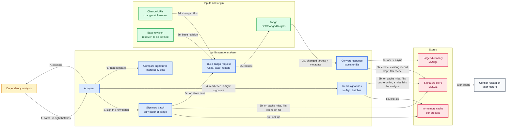
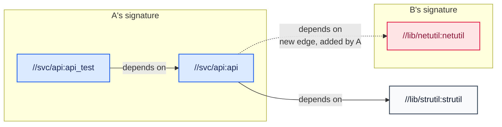

# Tango Conflict Analyzer

A `conflict.Analyzer` that treats two batches as conflicting when Tango reports a changed build target in common.

## Overview

`pathoverlap` compares changed file paths, so it misses conflicts that travel through the build graph, and at directory granularity it serializes sibling-file edits that do not conflict. Tango computes the changed-target set, including transitive dependents. Asking Tango for every in-flight batch on every admission is too slow, so the analyzer keeps each batch's result and reuses it. A later feature, [conflict relaxation](speculation.md#conflict-relaxation), reads the same data; how it uses it is out of scope.

The `conflict.Analyzer` contract is unchanged. The backend lives at `submitqueue/extension/conflict/tango/` beside `pathoverlap`, and a `tango` analyzer type is added in `service/submitqueue/orchestrator/server/profiles.go`. The analyzer represents each batch by a signature, the 64-bit IDs of the targets it changes, keeps signatures in a durable store with an in-memory cache in front, keeps a dictionary from each ID back to its label, and reports two batches as conflicting when their signatures share an ID.

## Data flow



| Step | What it is |
| --- | --- |
| 1 | Dependency analysis passes the batch and the in-flight batches to the analyzer |
| 2 | The analyzer signs the new batch |
| 3a | Look in the in-memory cache, in case this batch was signed before |
| 3b | On a cache miss, look in the signature store; a hit fills the cache |
| 3c | On a store miss, take the Tango path; this is the only path that calls Tango |
| 3d | The change URIs feed the Tango request |
| 3e | The base revision feeds the Tango request |
| 3f | The request goes to Tango |
| 3g | Changed targets and metadata come back to the converter |
| 3h | The converter creates the signature, keeping any existing record, and fills the cache |
| 3i | The converter sends labels to the dictionary, asynchronously |
| 4 | The analyzer reads the signature of each in-flight batch |
| 5a | Look in the in-memory cache |
| 5b | On a cache miss, look in the signature store; a hit fills the cache, and a miss fails the analysis, with no Tango call |
| 6 | The analyzer compares each signature |
| 7 | The analyzer returns the conflicts to dependency analysis |

## Stores and caches

| | Signature store | Target dictionary | In-memory cache |
| --- | --- | --- | --- |
| **Entity** | `TargetSignature` | `TargetLabel` | same `TargetSignature` |
| **Holds** | Per batch: sorted `(ID, distance)` entries, base revision | Per ID: its label | Signatures this process has seen |
| **Key** | `(queue, batch ID)` | `(queue, ID)` | `(queue, batch ID)` |
| **Durable** | Yes | Yes | No |
| **Written** | Once per batch, create-if-absent, before the batch is promoted to `Created` | When a Tango response is decoded; asynchronous, best-effort, idempotent | On a miss, after the store or Tango answers |
| **Read by** | The analyzer; relaxation | Debugging and conflict explanations; never the conflict check | The analyzer |
| **Lifetime** | Created once, never updated | Per queue; a row is added when a batch first brings its target, then never changed | Evicted when a batch leaves the in-flight set, or LRU when over the memory budget |

The two stores are interfaces under `submitqueue/extension/storage`, added to the orchestrator's storage interface only, so the gateway cannot reach them. MySQL is the first implementation.

A signature is written once and never recomputed: refetching from Tango later would use a newer base and could give a different answer. The in-memory cache can be dropped at any time and costs only store reads.

## Entities

`TargetSignature` and `TargetLabel` are immutable records under `submitqueue/entity/`. `SignatureTarget` is a value inside a signature. Each store instance serves a single queue, so a read takes only the batch ID or target ID.

```go
// TargetSignature is the set of build targets a batch changes, as 64-bit IDs.
type TargetSignature struct {
    // Queue is the queue the batch belongs to. Unique together with BatchID.
    Queue string
    // BatchID is the canonical decimal batch identifier, unique within Queue.
    BatchID string
    // BaseRevision is the commit SHA the changed targets were computed against.
    BaseRevision string
    // Targets is sorted ascending by ID, with no duplicate IDs.
    Targets []SignatureTarget
    // CreatedAt is the Unix milliseconds timestamp when the record was created.
    CreatedAt int64
}

// SignatureTarget is one changed target.
type SignatureTarget struct {
    // ID is the 64-bit hash of the target's label.
    ID uint64
    // Distance is the distance from the nearest directly changed source in the
    // reverse dependency graph; 0 means directly changed.
    Distance int32
}

// TargetLabel is one label and the ID it hashes to.
type TargetLabel struct {
    // Queue is the queue the label was seen in. Unique together with ID.
    Queue string
    // ID is the 64-bit hash of Label.
    ID uint64
    // Label is the target label exactly as the build graph reported it.
    Label string
    // CreatedAt is the Unix milliseconds timestamp when the record was created.
    CreatedAt int64
}
```

- **Create and read.** Both stores' `Create` returns `ErrAlreadyExists` if the record exists, so the first record written stays and repeating a write is harmless. Each store reads by its key alone: batch ID for signatures, target ID for the dictionary.
- **Hash collisions.** Two labels can share an ID, so the dictionary may hold a label other than the one a signature entry came from. The first label written stays. When a write finds a different label already stored, the writer counts and logs a collision, so it never happens silently. The conflict check never reads the dictionary, and a collision only adds a false conflict, so the effect is limited to a wrong label in a debugging view.
- **Signature encoding.** The targets are stored as one binary value: per target, an 8-byte big-endian ID and a varint distance. At about 9 bytes per target, a typical batch of a few thousand targets is tens of KB, and the largest requests, with millions of targets, are tens of MB. The first MySQL schema uses a `LONGBLOB` column, so no request fails on a column limit.

## Tango request and response

**Request.** `first_revision` is the base alone: the remote and the newest base SHA, with no requests. `second_revision` is the same remote and base plus one `Request` per change URI, in `batch.Contains` order, so a multi-request batch is one call. Both revisions use the same `strategy`, which comes from queue configuration. Set `output_config.max_distance` to `-1`, because once `output_config` is present an unset value means zero and drops every transitive target; leave hashes, tags and attributes off.

**Interface.** The analyzer sends this request through a small interface that returns label and distance pairs, and an adapter owns the Tango client and the stream. Each deployment supplies its own adapter, the generated Tango types stay out of the extension, and tests use a fake.

**Response to signature.** `GetChangedTargets` streams `ChangedTarget` chunks and then one `Metadata` message. A `ChangedTarget` has a change type, a distance, and `old_target` and `new_target`, whose IDs are local to the response. Labels exist only in `Metadata.target_id_mapping`, which arrives last. The adapter does Collect and the `target_id_mapping` label lookup from step 2, and returns label and distance pairs; the analyzer does the rest of Hash, then Merge and Dictionary.

1. **Collect.** For each `ChangedTarget` keep the local ID of `new_target` (`NEW`, `CHANGED`) or `old_target` (`DELETED`), with its distance. Keep only these two values so a multi-million-target response is not buffered whole.
2. **Hash.** At the end of the stream, map each local ID through `target_id_mapping` and hash the label. The ID is the first 8 bytes of the SHA-256 of the label exactly as Tango returned it, read big-endian. A collision only adds a false conflict. The analyzer does no normalization, so Tango's label format must stay stable.
3. **Merge.** Sort by ID. If two labels share an ID (a collision), keep the smaller distance.
4. **Dictionary.** Write each label to the dictionary under its ID, asynchronously.

The signature uses only each target's ID (from `new_target`, or `old_target` for `DELETED`), its `distance` and its label from `target_id_mapping`. Everything else in the response is skipped:

- `change_type`, beyond choosing `new_target` or `old_target`. New, changed and deleted targets count the same.
- `direct_dependencies` on each target. [Known gap](#known-gap-missed-conflicts) describes a rule that would use them.
- Hashes, tags and attributes, which the request turns off, and each target's rule type, `root` and `external` fields.
- The `Metadata` maps for rule types, tags and attributes.

An empty signature is valid and conflicts with nothing.

### Example

Pull request 123 edits a source file of `//lib/strutil:strutil`, adds the target `//lib/strutil:fuzz_test` and removes `//lib/strutil:legacy`. In the build graph `//svc/api:api` depends on `strutil`, and `//svc/api:api_test` depends on `api`.

Tango is asked for the changes between the base and the base plus PR 123.

Tango streams the changed targets, then the labels. The IDs are local to this response:

| Item | Change type | Target (local ID) | Distance | `direct_dependencies` (skipped) |
| --- | --- | --- | --- | --- |
| `ChangedTargets` | `CHANGED` | `new_target` 3 | 0 | none |
| `ChangedTargets` | `CHANGED` | `new_target` 1 | 1 | 3 |
| `ChangedTargets` | `CHANGED` | `new_target` 4 | 2 | 1 |
| `ChangedTargets` | `NEW` | `new_target` 2 | 0 | 3 |
| `ChangedTargets` | `DELETED` | `old_target` 5 | 0 | none |
| `Metadata` | | `target_id_mapping`: 1 `//svc/api:api`, 2 `//lib/strutil:fuzz_test`, 3 `//lib/strutil:strutil`, 4 `//svc/api:api_test`, 5 `//lib/strutil:legacy` | | |

The `direct_dependencies` column lists the local IDs of what each target depends on; the signature does not use it. Collect keeps the pairs (3, 0), (1, 1), (4, 2), (2, 0) and (5, 0). Hash maps each local ID to its label and hashes it. Merge sorts by ID, giving the signature stored for the batch:

| ID (hex) | Label | Distance |
| --- | --- | --- |
| `735cc8dafbb93f02` | `//lib/strutil:legacy` | 0 |
| `90afc9166e08f639` | `//lib/strutil:strutil` | 0 |
| `a9becee9e924a370` | `//lib/strutil:fuzz_test` | 0 |
| `bb211c1937bbeab8` | `//svc/api:api` | 1 |
| `c48fa23bb87b90f4` | `//svc/api:api_test` | 2 |

The dictionary receives the same five ID and label pairs.

The signature catches a conflict that comparing paths cannot see. The pull request only touches files under `//lib/strutil`, yet its signature includes `api` and `api_test`, because they depend on `strutil`. A later batch that edits only `//svc/api:api` has `api` at distance 0 and `api_test` at distance 1, so it shares `bb211c1937bbeab8` and `c48fa23bb87b90f4` with this one, and the two conflict. `pathoverlap` sees different paths and runs them in parallel, although the later batch changes code that this pull request's change affects.

### Tango errors

The analysis can fail in these ways:

- The stream ends with an error or is cancelled.
- The stream has no `Metadata`.
- A local ID has no label, or two different labels.
- A `NEW` or `CHANGED` target lacks `new_target`, or a `DELETED` one lacks `old_target`.
- The change type is `INVALID`.
- Tango returns any other error or times out.

Any of these fails the analysis. The analyzer fails closed, and any fallback belongs outside SubmitQueue.

## Algorithm

Two batches conflict when their ID sets intersect; distance is stored for relaxation and does not affect the decision. Names are descriptive, not a proposed API. In the [Data flow](#data-flow) diagram, "sign new batch" is `signNew`, "read signatures" is `recordedSignature` for each in-flight batch, "build Tango request" is `requestFor`, and "convert response" is `convert`.

```go
// Analyze returns the in-flight batches whose signatures share an ID with the
// batch's, in in-flight order. A failure to get any signature fails the analysis.
func Analyze(ctx, batch, inFlight) ([]Conflict, error) {
    mine, err := signNew(ctx, batch)
    if err != nil {
        return nil, err
    }
    var conflicts []Conflict
    for _, other := range inFlight {
        theirs, ok, err := recordedSignature(ctx, other)
        if err != nil {
            return nil, err
        }
        if !ok {
            return nil, ErrNoSignature // an in-flight batch was admitted with a signature; never ask Tango for it
        }
        if intersects(ids(mine), ids(theirs)) {
            conflicts = append(conflicts, Conflict{other.ID, ConflictTypeTargetOverlap})
        }
    }
    evictAllExcept(batch.Queue, inFlight, batch)
    return conflicts, nil
}

// recordedSignature returns b's signature from the cache, then the store. It
// never calls Tango.
func recordedSignature(ctx, b Batch) (Signature, bool, error) {
    if sig, ok := cache.Get(b.Queue, b.ID); ok {
        return sig, true, nil
    }
    sig, ok, err := store.Get(ctx, b.Queue, b.ID)
    if err != nil || !ok {
        return Signature{}, false, err
    }
    cache.Put(b.Queue, b.ID, sig)
    return sig, true, nil
}

// signNew returns the signature of the batch being admitted. A record exists
// only if an earlier attempt on this batch got this far and a later step failed,
// so it is used as it stands. Otherwise Tango is called, and the signature is
// created in the store before it is returned, so every reader sees the same one.
func signNew(ctx, b Batch) (Signature, error) {
    sig, ok, err := recordedSignature(ctx, b)
    if err != nil || ok {
        return sig, err
    }

    resp, err := tango.GetChangedTargets(ctx, requestFor(b)) // newest base
    if err != nil {
        return Signature{}, err
    }
    sig, labels, err := convert(resp)
    if err != nil {
        return Signature{}, err
    }
    dictionary.Put(ctx, labels) // asynchronous, best effort

    err = store.Create(ctx, b.Queue, b.ID, sig)
    if errors.Is(err, ErrAlreadyExists) {
        sig, _, err = store.Get(ctx, b.Queue, b.ID) // someone else created it first; use the stored one
    }
    if err != nil {
        return Signature{}, err
    }
    cache.Put(b.Queue, b.ID, sig)
    return sig, nil
}
```

- **Steady state** costs one Tango call and one store read, both for the new batch itself; the read finds nothing unless an earlier attempt already signed it. In-flight batches cost no reads, because each was cached when it was admitted.
- **Failing closed.** A store error or a missing record for an in-flight batch fails the analysis, and Tango is never asked for it. A signature recomputed later would use a newer base and could differ from the one the batch was admitted with, and a systematic store problem would otherwise turn into a burst of Tango calls that hides the original fault.
- **Switching a queue to `tango`.** Batches admitted before the switch have no record, so the in-flight set must be empty at the switch: drain or pause the queue first. Backfilling signatures for in-flight batches is out of scope.
- **Cold start.** After a restart, deploy or rebalance, the in-memory cache is empty, so the first analysis reads one signature per in-flight batch from the signature store. The cost grows with the number of in-flight batches: at about 5 ms per point read, done in parallel, roughly 2,000 batches load in about a second and 20,000 in about ten. Beyond that range a target-to-batch posting index would be the next step.
- **Eviction** drops the queue's cached signatures for batches not in `inFlight`, so memory tracks the in-flight set. That rule only runs when the queue is analyzed, so a byte-bounded LRU across all queues backs it up for queues that go idle or move to another controller. A wrong eviction costs one store read, so the budget needs no careful tuning.
- **Concurrency.** Dependency analysis is partitioned by queue, so one queue is analyzed at a time. Signature lookups for different batches may run at the same time, up to a fixed limit.
- **Idempotency.** A redelivery after the new batch was signed finds its own record in the cache or store and reaches the same signature without calling Tango.

## Known gap: missed conflicts

This is a known limitation to watch once a queue is switched to `tango`, not something the algorithm needs in order to work. Comparing the targets each batch changes misses conflicts that travel through a dependency edge one of the batches adds. The signature records changed targets, not changed edges. Tango's `direct_dependencies` lists would show the edges, and the first version doesn't read them.

Start from the build graph in the [example](#example), where `//svc/api:api_test` depends on `//svc/api:api`, which depends on `//lib/strutil:strutil`. Two other batches arrive. Batch A edits the `BUILD` file of `//svc/api:api` so that it also depends on `//lib/netutil:netutil`, and batch B edits the source of `netutil`. A's signature holds `api` at distance 0 and `api_test` at distance 1, but not `netutil`, which A did not change. B's signature holds only `netutil`, because on the base graph `api` does not yet depend on it. They share no ID, so A and B run in parallel, but once both land `api` depends on a changed `netutil` and that combination was never built.



The dashed edge is in neither signature, so the two signatures share no target.

Comparing signatures as they stand misses a meaningful share of such pairs. Two optional rules close the gap, per queue, and are turned on only if the misses matter once a queue runs on `tango`:

- **New-edge rule.** Add the destination of each new dependency edge (here `netutil`) to the signature of the batch that created the edge, so A's signature shares `netutil` with B's. An earlier production implementation already applies this rule, and the rule removes most of these misses. Tango's response should carry what it needs: the `direct_dependencies` lists that the Example skips, shown below (see [Open questions](#open-questions)).
- **Inheritance.** Signatures are never recomputed, so one cached before a batch that adds an edge or a target lands does not know the targets reachable through the new edge. Inheritance adds the signatures of the batches it depends on that did this, recorded at admission. It removes the remaining misses, at the cost of many more false conflicts than the new-edge rule alone. It needs each batch to record at admission whether it added an edge or a target, which cannot be recovered for batches already admitted.

How often these misses happen in production is not known. Commits that bypass the queue break the assumption behind every rule, that only landed batches change the base.

**Worked example: the new-edge rule on A.** A's response in the format of the Example, with its own local IDs. `netutil` appears only because `api` depends on it:

| Change type | Target (local ID) | Distance | Old `direct_dependencies` | New `direct_dependencies` |
| --- | --- | --- | --- | --- |
| `CHANGED` | `new_target` 1 | 0 | 3 | 3, 4 |
| `CHANGED` | `new_target` 2 | 1 | 1 | 1 |
| `Metadata` | `target_id_mapping`: 1 `//svc/api:api`, 2 `//svc/api:api_test`, 3 `//lib/strutil:strutil`, 4 `//lib/netutil:netutil` | | | |

For each `CHANGED` target the rule keeps the dependencies in the new list but not the old one. For `api` that is 4, `netutil`. Tango reports no distance for a target it did not change, so the rule adds it at distance 0. A's signature becomes `api` (0), `api_test` (1) and `netutil` (0), which shares `netutil` with B's, so the two now conflict.

## Rejected alternatives

- **Tango's whole response as the signature.** The largest responses have millions of targets, so one takes gigabytes of heap, and a few of them in flight make a cold start slow.
- **Falling back to Tango for an in-flight batch with no record.** It would mask a store fault, send Tango a burst of requests exactly when something is already wrong, and produce a signature from a newer base than the one the batch was admitted with.
- **Sorted labels.** Roughly an order of magnitude larger to store and to hold in memory than IDs, before counting the dictionary, with no benefit the dictionary does not already give.

## Open questions

- **Base SHA source.** Nothing in the orchestrator resolves the target branch tip. Candidates are a resolver that reads the tip from the remote, or the PR's own base. The queue config also needs the repo and branch, and the Tango `remote` format (`org/repo` per the proto, a clone URL per the README) is unconfirmed.
- **Non-GitHub change schemes.** Tango parses only `github://` PR URIs, so each other scheme needs Tango support or a conversion step on our side. Until then, queues on those schemes (such as `phab://`) keep `pathoverlap` or `all`.
- **Oversized signatures.** `LONGBLOB` avoids MySQL column limits, but a backend with an item limit would need either chunking or a size cap that treats such a batch as conflicting with everything. Deferred until rollout data shows how many real batches are that large.
- **Recording added edges and targets.** Whether each signature records, at admission, that its batch added a dependency edge or a target. Inheritance needs it, so the Collect step of [Response to signature](#tango-request-and-response), which keeps only IDs and distances today, would have to read the dependency lists. Without it, inheritance can only apply to batches admitted after it ships.
- **Dependency lists.** The proto carries `direct_dependencies` on `old_target` and `new_target`; whether both are populated for every changed target is unconfirmed.
- **Retention.** Whether signature rows are deleted on terminal state or left to a general retention policy. Dictionary rows are shared across batches and have no batch to attach a deletion to, so only a queue-level policy applies to them.
